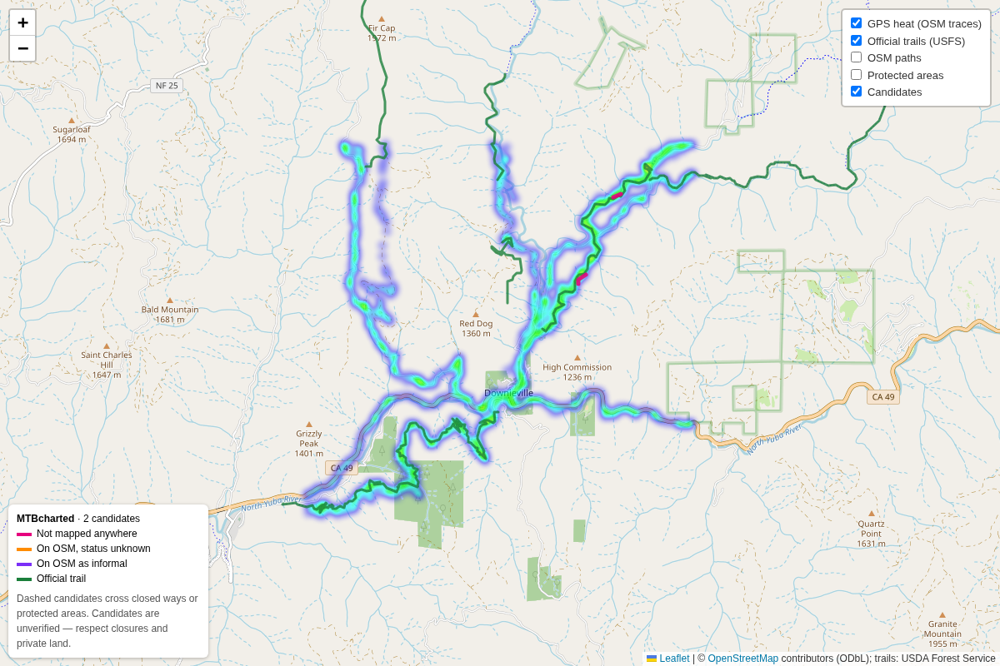

# MTBcharted — unofficial trail finder (prototype)

A proof-of-concept for MTBcharted. It compares where people actually ride (a GPS
heatmap) with the official trail network and reports the ridden lines that aren't
on it.

This lives alongside PowerZone Ride for now but has nothing to do with it; it can
move to its own repo whenever that's convenient.



## Data sources

| Layer | Source | Licence |
|---|---|---|
| Where people ride | [OpenStreetMap public GPS traces](https://wiki.openstreetmap.org/wiki/API_v0.6#Retrieving_GPS_points) | ODbL, attribute "© OpenStreetMap contributors" |
| Official trails | [USFS National Forest System trails](https://apps.fs.usda.gov/arcx/rest/services/EDW/EDW_TrailNFSPublish_01/MapServer) | US public domain |
| Mapped paths, roads, access tags, protected areas | OpenStreetMap via [Overpass](https://wiki.openstreetmap.org/wiki/Overpass_API) | ODbL |

**Why not the Strava heatmap?** Its tiles need a logged-in Strava session (anonymous
requests get a 403), and Strava's terms forbid scraping them. The Strava API only
returns a user's own activities, not the aggregate heatmap. Legitimate routes to
denser data are [Strava Metro](https://metro.strava.com/) (for land managers and
advocacy groups), a Trailforks API partnership, or letting MTBcharted riders upload
their own GPX, which is the plan for the app.

OSM traces are far sparser than Strava's. In popular areas it's enough to see the
main lines, but in most places the heat will be thin.

## How it works

1. **Heat.** Trackpoints are rasterized into a 10 m grid (in local UTM). Consecutive
   timed points are joined when they're less than 60 m apart. Segments faster than
   about 40 km/h are dropped as driving. A cell counts as ridden when at least 2
   distinct traces cross it.
2. **Known network.** Cells within 25 m of these are masked out:
   - USFS trails
   - OSM paths tagged `operator=*`, `informal=no` or `bicycle=designated`
   - any OSM way that isn't a trail (`highway` other than path/footway/bridleway/cycleway)

   Roads carry lots of car traces, and `highway=track` dirt roads are already mapped.
3. **Lines.** The remaining cells are skeletonized into centre lines. Lines shorter
   than 100 m are dropped.
4. **Labels.** Each candidate gets one of:
   - `unmapped`: nothing on OSM follows it
   - `osm_path`: an OSM path follows it, with no official status
   - `osm_informal`: an OSM path tagged `informal=yes` follows it
5. **Warnings.** A candidate gets a `flags` entry when it touches an OSM way tagged
   `access=no/private` or `bicycle=no/dismount`, or a protected area where bikes or
   access are prohibited, or one of IUCN class 1a/1b (strict reserve or wilderness).
   Ordinary multi-use land such as national forests goes in `within` instead, so you
   can see who manages it.

## Running it

```sh
pip install -r mtbcharted/requirements.txt
python -m mtbcharted.analyze --area downieville --bbox=-120.87,39.54,-120.79,39.60
```

The bbox is `west,south,east,north`. The OSM trackpoints API caps it at 0.25 square
degrees. Downloads are cached in `mtbcharted/data/<area>/` (gitignored). Pass
`--refresh` to fetch again. The run writes:

- `candidates.geojson`: candidate lines with `label`, `length_m`, `mean_traces`,
  `osm_names`, `flags` and `within`
- `map.html`: a standalone Leaflet map with the heat, official trails, OSM paths,
  protected areas and candidates. Open it in any browser.

Other options: `--min-traces`, `--min-length` and `--max-trace-pages`.

Tests use synthetic data and need no network:

```sh
python -m pytest mtbcharted
```

## Responsible use

A candidate is a line in GPS data, nothing more. It may be a closed trail, a
restoration area, private land, a game trail someone once walked, or GPS drift
alongside a real trail. Before MTBcharted shows candidates to riders it should:

- show access status and land manager prominently, and never hide a closure flag
- treat anything in wilderness or behind `access=no/private` as off limits, not as a discovery
- give land managers a way to report closures and have lines removed
- keep OSM attribution visible wherever this data is shown
